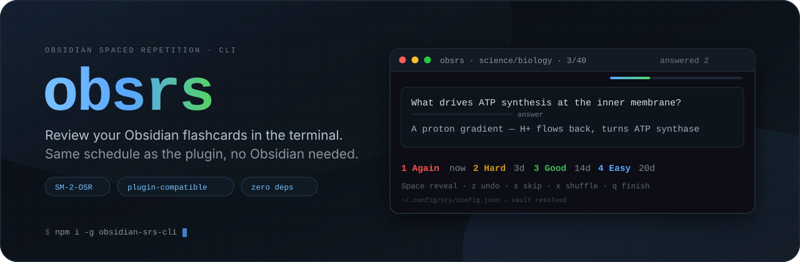

# obsrs



**English** · [简体中文](README.zh-CN.md)

Terminal UI for [obsidian-spaced-repetition](https://github.com/st3v3nmw/obsidian-spaced-repetition) flashcards.
It reads and writes the **same inline schedule comments** the plugin uses
(`<!--SR:!date,interval,ease-->`), so you can review in the terminal and in Obsidian
on the same vault without the progress fighting itself.

The plugin ships no CLI, so this is a port of its v1.15.4 implementation
(SM-2-OSR scheduler + line-oriented parser + settings). Node.js ≥18, zero dependencies,
`node:test` suite included.

> Names, decks and cards in the screenshots below are fictional placeholders.

## Install

```bash
npm i -g obsidian-srs-cli     # installs the command `obsrs`
obsrs --version
```

- The **command** is `obsrs`, the **package** is `obsidian-srs-cli` — same split as
  `ripgrep` → `rg`. `npx obsidian-srs-cli` works too, and `srs` is left free for other tools
  (`alias srs=obsrs` if you want the short name).
- From source: `node /path/to/obsidian-srs-cli/srs.js`.

## Configure your vault (once)

No paths are hardcoded — you tell it where the vault is, in this order of precedence:

```bash
obsrs config --vault ~/Documents/Notes    # remembered in ~/.config/srs/config.json
export SRS_VAULT=~/Documents/Notes        # current shell only
obsrs --vault /path/to/your/vault         # this run only
```

- `obsrs config` shows the config file, the saved vault, what is in effect and where it came from;
  `obsrs config --unset` clears it.
- Run it in a terminal with no config and it asks for the path once, then remembers it.
- Writes validate that the directory actually contains
  `.obsidian/plugins/obsidian-spaced-repetition/data.json`.
- Config location: `$SRS_CONFIG` > `$XDG_CONFIG_HOME/srs/config.json` > `~/.config/srs/config.json`
  (`%APPDATA%\srs\config.json` on Windows).

## Home screen

```
 obsrs · review Obsidian flashcards                                    Notes
 Today 2026-05-12   12 due · 34 new · 96 total
 ▸ All decks                                  12 due    34 new     96 total
   science/biology                             5 due    18 new     40 total
   cs/networking                               4 due    10 new     31 total
   history                                     3 due     6 new     25 total
 ↑↓ select  Enter start  n new  d due  m order·plugin  r reload  ? help  q quit
 All decks · 12 due / 34 new · order: plugin settings (deck by deck)
```

Decks with work to do float to the top. `Enter` starts (due + new), `n` new only, `d` due only.

## Review screen

```
 obsrs · science/biology · 3/40                        ██████░░░░░░░░ answered 2
┌──────────────────────────────────────────────────────────────────────┐
│ What drives ATP synthesis at the inner mitochondrial membrane?       │
│ ────────────────────────── answer                                    │
│ A proton gradient: H+ flows back down it and turns ATP synthase      │
└──────────────────────────────────────────────────────────────────────┘
 biology-srs · due 2026-05-10 · interval 6d · ease 230
 1 Again now · 2 Hard 3d · 3 Good 14d · 4 Easy 20d
 1-4 grade  z undo  s skip  x shuffle  ↑↓ scroll  ? help  q finish
```

Every grade tells you **what interval pressing it would schedule**, so you never guess.
Revealing is a separate keystroke from grading — a stray `3` cannot answer for you.
The card box shrinks to its content, long answers scroll, and `x` reshuffles what you haven't seen yet.

## Summary

```
 obsrs · Session complete
       ┌────────────────────────────────────────────────┐
       │  12 answered   in 4m 32s                       │
       │  Again 2   Hard 3   Good 5   Easy 2            │
       │  next up: 2026-05-13 (8 cards)                 │
       └────────────────────────────────────────────────┘
 Enter home   q quit
```

## Commands

```bash
obsrs                          # home screen (pick deck → review → summary)
obsrs review                   # jump straight into a session
obsrs review -d science -n 20  # one deck, at most 20 cards
obsrs review --new-only        # new cards only (--due-only for due only)
obsrs review --dry-run         # run through without writing anything
obsrs review --shuffle         # shuffle across decks
obsrs review --no-backup       # don't write a note backup this run
obsrs status [--json]          # text summary (scripts / CI)
obsrs list [-d deck]           # list cards and schedules
obsrs config [--vault <dir>|--unset]
obsrs --version
```

## Keys

| Screen | Key | Action |
|---|---|---|
| Home | `↑↓` / `k j` | previous / next deck |
| | `Enter` / `a` | start (due + new) |
| | `n` / `d` | new only / due only |
| | `m` | switch order: plugin settings ↔ shuffle across decks |
| | `r` | reload the vault (after editing notes elsewhere) |
| Review | `Space` / `Enter` | reveal |
| | `1-4` or `a h g e` | Again / Hard / Good / Easy |
| | `z` | undo the last card |
| | `s` | skip this card (no schedule written) |
| | `x` | reshuffle the cards you haven't seen |
| | `↑↓` / `j k` | scroll long answers |
| Anywhere | `?` | keyboard help |
| | `q` | back / finish |

When stdout is redirected or piped it degrades to line-by-line Q&A (force it with `--plain`),
so the same state machine works in scripts.

## Card order

`m` on the home screen switches, `x` reshuffles mid-session:

- **plugin settings** (default, identical to the plugin): follows `flashcardDeckOrder` /
  `flashcardCardOrder` — shuffled inside a deck, but decks are finished one at a time.
- **shuffle** (`--shuffle`, or `m`): the whole selection is shuffled across decks, so a
  biology card can be followed by a networking card.

## Fidelity to the plugin

- All settings come from the plugin's own `data.json`: separators, `baseEase`, `easyBonus`,
  `lapsesIntervalChange`, `loadBalance`, `maximumInterval`, card and deck ordering.
- Scheduling follows `osrSchedule()`: Good = interval × ease; Easy adds 20 ease and multiplies by
  easyBonus; Hard multiplies the interval by `lapsesIntervalChange` and drops ease by 20; Again
  resets to zero and requeues the card at the end of the session. With `loadBalance` on, the
  interval is fuzzed against the vault-wide due-date histogram (ported
  `findLeastUsedIntervalOverRange`) — including the detail that it rounds **even when the histogram
  is empty** (so a new card's Good is 3 days, not 2.5).
- A new card's starting ease is the average ease of that note's scheduled cards, snapshotted when
  the note loads — same as the plugin.
- The card set has been checked deck-by-deck against the plugin's own deck tree (`status --json`).

## Writing to your notes

This tool **edits your notes**, so it behaves like this:

- atomic writes (temp file + `rename`), original line endings (LF/CRLF) and file permissions preserved;
- the `<!--SR:` count is verified before the write lands — if it would change, nothing is written;
- every note is backed up first to `$XDG_STATE_HOME/srs/backups/<timestamp>/`
  (default `~/.local/state`), keeping the last 20 (`SRS_BACKUP_KEEP`); disable with
  `--no-backup` or `SRS_NO_BACKUP=1`;
- exit codes: `0` ok, `2` bad argument/configuration, `1` unexpected error;
- best practice: let Obsidian save / close that note first — the editor buffer does not follow
  external writes, and its next save can overwrite them.

## Language

English and Chinese, chosen from `$LANG` (`en*` → English, anything else → Chinese) or forced with
`SRS_LANG=en` / `SRS_LANG=zh`. Card content is never translated — that's your own writing.

## Structure

```
srs.js              entry point: args, commands, home → review → summary flow
src/config.js       vault resolution (--vault > $SRS_VAULT > config file)
src/vault.js        vault validation + plugin settings
src/parser.js       card parsing (line-oriented, quirks included)
src/schedule.js     SM-2-OSR + grade previews + date math
src/store.js        write-back, backups/cleanup, undo, line resync
src/session.js      queue building + session state (terminal-agnostic)
src/i18n.js         English / Chinese strings
src/plain.js        non-TTY line mode
src/ui/*.js         alternate screen, drawing primitives, three screens
test/*.test.js      45 node:test cases
```

```bash
npm test
```

## Not supported

Reversed cards (`:::` / `??`), cloze (`==`), whole-note review, `burySiblingCards`, FSRS scheduling.
They are reported and skipped rather than silently mangled.

## License

MIT — see [LICENSE](LICENSE).
